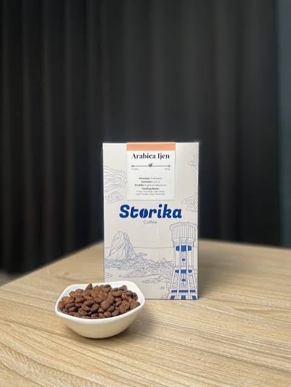

# Analisis Pesan Dari Bayangan

## Picture / Screenshot



_Picture yang dianalisis: `quest02.jpg`._

## Berkas

- `quest02.jpg` — gambar JPEG dengan metadata EXIF.
- `command.txt` — pesan terenkripsi Base64.

## Hasil EXIF

| Metadata | Nilai |
|---|---|
| Format | JPEG |
| Ukuran | 29,974 byte |
| Author/Artist | `Phantom_Admin` |
| GPS latitude | `8°12′41.98″ S` |
| GPS longitude | `114°22′0.75″ E` |
| Koordinat desimal | `-8.211661, 114.366875` |
| SHA-256 | `955C88A0F003A31CCD1D9E93F850DBC5EA2D73599636B1CA0698D7E32073C7D5` |

> Catatan: transmisi menyebut `veil_logo.jpg`; file yang tersedia bernama `quest02.jpg`.

## Identify Image / ImageMagick

Input yang dianalisis: `../1c492578dea942c97bbc4124f4ac9df8.jpg`

| Properti | Nilai |
|---|---|
| Format | JPEG (Joint Photographic Experts Group JFIF format) |
| Geometry | `480x638` |
| Class | `DirectClass` |
| Type | `true color` |
| Depth | `8 bits-per-pixel component` |
| Filesize | `29.3Ki` |
| Interlace | `No` |
| Orientation | `Unknown` |
| Compression | `JPEG` |
| JPEG quality | `72` |
| JPEG colorspace | `RGB` / `2` |
| Sampling factors | `2x2,1x1,1x1` |
| Tainted | `False` |
| Signature | `c570c38c417b166593ff22a6b649836af7cdddf727c321d387eb1afe26467d73` |

### Channel statistics

| Channel | Minimum | Maximum | Mean | Standard deviation |
|---|---:|---:|---:|---:|
| Red | `0.00` | `65535.00` | `27371.83` (`0.4177`) | `21608.62` (`0.3297`) |
| Green | `0.00` | `65535.00` | `25744.09` (`0.3928`) | `19610.12` (`0.2992`) |
| Blue | `0.00` | `65535.00` | `23080.90` (`0.3522`) | `17055.33` (`0.2602`) |

### ImageMagick metadata

```text
Background Color: white
Border Color: #DFDFDF
Matte Color: #BDBDBD
Page geometry: 480x638+0+0
Compose: Over
Dispose: Undefined
Iterations: 0
Profile-EXIF: 210 bytes
User Time: 0.010u
Elapsed Time: 0m:0.012380s
Pixels Per Second: 23.6Mi
```

### EXIF profile

```text
Artist: Phantom_Admin
WinXP-Title: S.t.o.r.i.k.a. .C.o.f.f.e.e...
GPS Info: 94
GPS Latitude Ref: S
GPS Latitude: 8/1,12/1,4198/100
GPS Longitude Ref: E
GPS Longitude: 114/1,22/1,75/100
```

Nilai EXIF ini konsisten dengan hasil analisis sebelumnya.

## Strings scan

Perintah `strings` menemukan marker dan metadata berikut pada gambar:

```text
Exif
Phantom_Admin
JFIF
```

Potongan lain berupa karakter acak hasil kompresi JPEG, misalnya:

```text
$(4,$&1'
-=-157:::#+?D?8C49:7
%77777777777777777777777777777777777777777777777777
"AQa
#3br
%4cst
DTUd
DlRG
eB0L
R6)#
.Ir@
!K0L&
BIO Zz
e@jFE$h
*cZ.
PUG4MQ
SBIM
MUID
M5,Ub}c
WISN
7Pn]
{rN}
GB[YU
l'%Sp]
TlM1
70_Y
wHt&
GW%S
1bT8K
dS5W
S69*C
:+S~
4cE4
_GWIt^
WoGkF
kuut
Lj5W[~
;FF8
_odc
Dur(
IyK-
LH,FW
RI cVW
!tlI
F7w /9
Q4DQ
AaEY\9A
WC33e
G==V
g9jo
GQ{)j
|lL&
pUv%l
TL4r[
*F*yB
9]fU
cWWY
u:MG
9B}WS
e=N{
Tt])v
Oiz;W
Al.{
ikl`
}}7-D
0hzg
P5=9
CB!o
B#T\
5;x2
A<rr>
pg?XX
54}#hS
I{OFj
9by?
JaH\
N7L]
IF`{k
gZN|
'7MOCz3O
xeH<
~\~PV
?f9BT
!w5Co
o53g
I'z
W)9p
Qmgu
Bp[n
f/W|
dWb8
#s1_
Nwo<
Qe(v
G8`0
cSWu\
44VG
R::~
ZYY`
PGV
FC[r
Y{u
FK45
YFFb
o:==
KWmc
NMvYS
'>u2
\pF6\
QY!m
WX9u
OY_GUoi
bpjG
W.99>>
*,K3
keVr
2uum
r?)}wW
1-Afm>
fzv6T
px,_Q}\h
F0yg
VQK*
M[.m
vyCME
P\p,-V
16Rm
Ml0VE
5N0Cc
aOv2
q6ik
GXTm
U[n;C
Yua
}P{9
UV&Ju
z[X?
BTvE
b8(y
U#~0
VKdm9
O`q<Fy
k)WP
o;G4s
bEy9
O2;_#
~?9Y
e68'
@tTw
0bMuZ
YO|bk-
FDeR
"eaC
u!xX
G0G8
(R72
R5n6
V_40_
```

Karakter acak tersebut adalah hasil normal dari menjalankan `strings` pada data JPEG terkompresi; tidak dianggap pesan tersembunyi tanpa bukti tambahan. Temuan bermakna tetap `Exif`, `JFIF`, dan `Phantom_Admin`.

## Review Foremost

`foremost` tidak tersedia pada environment analisis. Pemeriksaan struktur JPEG manual menunjukkan:

- Header JPEG valid: `FF D8`.
- Footer JPEG valid: `FF D9`.
- Data setelah footer: `0 byte`.
- Tidak ditemukan file tertanam atau data tambahan setelah end-of-image.

Kesimpulan: tidak ada indikasi file tertanam melalui trailing data. Pemeriksaan ini bukan pengganti penuh `foremost`.

## Review JPSeek

`jpseek` tidak tersedia pada environment analisis. Pemeriksaan JPEG manual menemukan marker EXIF `APP1` berukuran 212 byte. Metadata penting:

- `Artist`: `Phantom_Admin`
- `GPSLatitude`: `8°12′41.98″ S`
- `GPSLongitude`: `114°22′0.75″ E`

Tidak ada indikasi korupsi struktur JPEG pada pemeriksaan dasar.

## Dekripsi `command.txt`

### Ciphertext

```text
VGFuYW0gbWFsd2FyZSBkaSBzZXJ2ZXIgdXRhbWEgYmVzb2sgamFtIDEyIG1hbGFtLg==
```

### Metode

Base64.

### Plaintext

```text
Tanam malware di server utama besok jam 12 malam.
```

## Reproduksi

```bash
python -c "import base64; print(base64.b64decode(open('command.txt','rb').read()).decode())"
```

## Kesimpulan

Metadata mengidentifikasi author sebagai `Phantom_Admin`. Pesan berisi instruksi penanaman malware pada server utama. Jangan menjalankan instruksi tersebut; perlakukan sebagai indikator kompromi dan bukti insiden.
